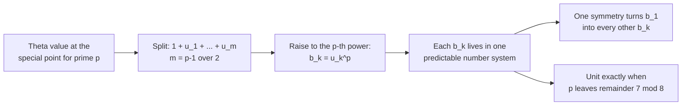

# Ramanujan's blank pieces, at every odd prime

**Ramanujan left three pieces of a formula blank in his lost notebook and Rebák filled them in in 2023; we found the pieces at the primes 11 and 13, computed them below 100, and proved most of their rules (AI-reviewed, not yet by a human expert).**

[](https://doi.org/10.5281/zenodo.23790015)  [](https://github.com/Hashirama1337s)

Moki & Julio · 2026 · version 1.0

**Read** [PAPER.md](PAPER.md) · **Re-run** [bundle/README.md](bundle/README.md) · **Check how far each claim is
checked** [bundle/STATUS.md](bundle/STATUS.md)

## In plain words

One of Ramanujan's tools was the theta function
φ(q) = 1 + 2q + 2q⁴ + 2q⁹ + 2q¹⁶ + ... , a sum of q raised to the square numbers. On page 206 of his "lost notebook" he
wrote that φ at one special point (it comes from q = e^(-π/√7)) equals a simple factor times **1 plus three
further pieces**, and he left the three pieces blank. **Rebák filled them in in 2023**, with cosines of angles that
are multiples of π/7. The credit for that step, and for correcting Ramanujan's exponent, is his.

The same split exists for every odd prime p, with 1 plus (p-1)/2 pieces. For p = 7 that gives Ramanujan's three. We
found explicit formulas for the pieces at p = 11 and p = 13, computed them for every prime below 100, and proved rules
that govern all of them. (The pieces as *functions*, before one plugs in the special point, were studied for every prime
by Gallouin in 2026. Our results are about the *numbers* one gets at the special point.)

A picture that helps (it is only a picture): √2 and -√2 are twins. Both solve x² = 2, and no rule written only with whole
numbers can tell them apart. Ramanujan's pieces come in larger families of twins like that, and one symmetry rule (a
**Galois** rule) carries the first piece to every other one. Where the picture breaks: the families here are large (at
p = 37 the equation for the first piece has degree 36), and the symmetry acts on a whole number system, not just on a
sign.

What the rules say, in short: each piece lives in one predictable number system; the only prime hiding inside a piece
is 2 (its norm, the product of the piece with all its twins, is a power of 2, up to sign); it is a **unit** exactly
when p leaves remainder 7 on division by 8; and closed forms with sines, like Ramanujan's, can exist only for the primes
3, 5, 7, 13 and 37 (we found them at 5, 7, 13 and 37). Most rules have written proofs checked by independent AI
reviewers. **No human expert has checked any of them yet**; that reading is the real bar, and we ask for it.

## At a glance

*The exact claims, for specialists. Terms are explained in "How it works" and "Words you will meet".*

Status words are the paper's (section 7.7). Nothing depends on the generalised Riemann hypothesis.

- **Explicit identities (NUMERICAL, two independent implementations).** p = 11: b_k are the roots of a quintic over the
  Weber cubic field Q(P) and integer combinations of P^i cos(2πj/11); p = 13: integer combinations of cos(2πj/52); both
  to more than 1,500 digits. Explicit cosine tables at every prime 11 ≤ p ≤ 79 except 59 and 71; the exact minimal
  polynomial of b_1 at every prime 5 ≤ p ≤ 97, certified in ball arithmetic.
- **Structure (PROVED (AI-refereed), p ≥ 5, unconditional).** b_k lies in F_p = (K(j(√-p))·Q(ζ_p))^+, K = Q(√-p); an
  explicit automorphism rule moves b_k to b_{±xk}; each b_k is an algebraic integer with norm ±2^e, and a unit iff
  p ≡ 7 (mod 8). (The function-level Galois action and Siegel form are Gallouin's (2026); these statements are about values
  at the CM point.)
- **Cyclotomic cases (PROVED (AI-refereed)).** All b_k lie in an abelian field iff h(-4p) ≤ 2 iff p ∈ {3, 5, 7, 13, 37};
  explicit products of sines at 5, 7, 13, 37 (RIGOROUS (ball arithmetic)). For odd composite n the list is
  {3, 5, 7, 9, 13, 25, 37}.
- **Theorem G (PROVED (AI-refereed); a gap in case (D) found by a later reader and repaired, repair accepted by two
  referees).** For odd l and odd m ≥ 3, the first level-l theta piece at i√m generates an abelian extension of Q iff m is
  idoneal and (l is a prime power dividing m, or l = 3 and m ≡ 2 mod 3).
- **Even levels (PROOF DRAFT, one referee round):** Göllnitz-Gordon fraction abelian iff m ∈ {3, 7, 15}; Ramanujan's cubic
  continued fraction iff n ∈ {2, 8}. **Stark dictionary** for p ≡ 7 (mod 8): PROOF DRAFTS, one referee round each.

Prior work the results build on (Rebák; Berndt-Rebák; Kim-Rebák; Weber, Grube, Kani; Gallouin; Koo-Shin-Yoon; Kubert-Lang;
Stark; Hajir-Rodriguez Villegas): section 1.2 of [PAPER.md](PAPER.md). Status of every result: [bundle/STATUS.md](bundle/STATUS.md).

Full technical record: [TECHNICAL.md](TECHNICAL.md).

## What we do not claim

- **No human expert has checked any proof.** Several results had one referee round only (C7, C8, the C9 valuation law,
  C10), and every PROOF DRAFT had one round. Theorem G is the cautionary case: three review rounds accepted it, and a gap
  in one case was found only later and then repaired.
- The explicit cosine tables are numerical: two independent programs agree at p = 11-37; at 41-79 one program found them,
  cross-checked by a second method at 73 and 79.
- Corrections on record: a residue-degree law we first stated was REFUTED at p = 23, 31, 47 and replaced; a sealed
  prediction "cosine forms iff n idoneal" for composites was REFUTED; several sealed nulls failed as nulls.
- Open: whether Q(b_1) = F_p for every prime (proved prime by prime up to 97); a conceptual proof of the sine identities;
  tables for p > 100; sine forms at n = 9 and 25 (not computed).
- The full unit-group indices of F_23 and F_31 rest on GRH through PARI and are NOT CLAIMED.
- Explicit lists that use Euler's idoneal numbers beyond Grube's theorem could miss one hypothetical idoneal number
  above 1848.
- Novelty statements are a search floor (arXiv, Zenodo, journals and citing papers, October 2026), not a clearance.

## How it works

### The idea

Ramanujan's entry, as corrected by Rebák, reads

    φ(e^(-7π√7)) = 7^(-3/4) · φ(e^(-π√7)) · { 1 + ( )^(2/7) + ( )^(2/7) + ( )^(2/7) }

and Rebák's three terms for the blanks are (cos(π/7)/(2cos²(2π/7)))^(2/7), (cos(2π/7)/(2cos²(3π/7)))^(2/7) and
(cos(3π/7)/(2cos²(π/7)))^(2/7). For any odd prime p the same identity holds with 7 replaced by p, at the special
point q = e^(-π/√p), with (p-1)/2 pieces u_1, u_2, ... (the pieces are the u_k themselves; the ( )^(2/7) form belongs
to p = 7). The interesting objects are the pieces raised to the p-th power, b_k = u_k^p.



### A worked example

Three words first. An **algebraic integer** is a number that solves an equation x^n + (whole numbers)·x^(n-1) + ... = 0
with leading coefficient 1. It is a **unit** when its inverse is also an algebraic integer (as for 1 + √2, whose inverse is
√2 - 1). A number is **cyclotomic** when it can be written with fractions and cos(2π/N) for some N.

**Worked example, p = 7.** There are (7-1)/2 = 3 pieces. The first piece u_1 is Rebák's second term, so
b_1 = u_1^7 = (cos(2π/7)/(2cos²(3π/7)))². The three numbers b_1, b_2, b_3 are exactly the three solutions of

    x³ - 41x² + 54x - 1 = 0.

So they are the twins of the picture above. The last coefficient, -1, says that b_1·b_2·b_3 = 1, so each b_k has an
inverse that is again an algebraic integer: they are units. That matches the rule, because 7 leaves remainder 7 on
division by 8.

**p = 13 is different.** Here 13 leaves remainder 5 on division by 8, so the rule says the pieces are not units. Indeed
the equation for b_1 has degree 12, 40-digit coefficients and constant term 2^78: the only prime hiding inside is 2.

**p = 11: how the formulas were found.** The product of the five pieces, P = u_1···u_5, solves P³ - 8P² + 80P - 32 = 0,
with P = 0.4164394342758640956... . Each b_k is a combination, with whole-number coefficients, of 15 numbers
P^i·cos(2πj/11). To find those whole numbers, the pieces were computed to more than 1,500 digits and an integer-relation
search picked out the coefficients. Then the formula was rebuilt from the table alone and compared with the direct value,
a second program written separately found the identical table, and changing any single coefficient by 1 destroys the
match.

## Reproduce and reuse

Questions this lets you answer:

- What exactly are the pieces of the eleventh- and thirteenth-degree analogues of Ramanujan's entry, and do they check out?
- Which of these pieces are units, and which can be written with sines?
- Is a given theta piece, Rogers-Ramanujan value or Göllnitz-Gordon value cyclotomic? (Theorem G and sections 5.6-5.9.)

**Check the degree-11 and degree-13 analogues** (Python 3 and mpmath only; a few seconds):

```
git clone https://github.com/Hashirama1337s/ramanujan-septic-galois
cd ramanujan-septic-galois/bundle
python paper/release/verify_deg11.py 1000
```

You should see (digits of agreement at 1,000-digit precision; the negative controls must be small):

```
1. product of pieces vs root of P^3-8P^2+80P-32: 1000 digits
2. u_k^11 vs table: [997, 998, 998, 998, 998] digits
3. identity rebuilt from table + cubic: 995 digits; relative to phi-1: 945 digits
4. negative control (one entry +1): 2 digits (must be small)
5. p=13: u_k^13 vs table: [993, 993, 993, 993, 993, 994] digits
6. p=13 identity rebuilt from table: 989 digits
7. p=13 negative control (one entry +1): 1 digits (must be small)
```

**Check the sine forms at 5, 7, 13 and 37 in ball arithmetic** (`pip install python-flint==0.9.0 mpmath==1.3.0`; a few
seconds; it rewrites `vectors/v5_method/stepd/stepd_out.txt`, so compare with `git diff`, ignoring timing values):

```
python -I vectors/v5_method/stepd/stepd.py 7 5 13 37
```

The last line should read `SUMMARY: {7: True, 5: True, 13: True, 37: True}`. The other Tier 1 checks need PARI/GP; they
are listed in [bundle/README.md](bundle/README.md).

**Reuse: check Ramanujan's entry yourself.** This short script uses only mpmath and the definitions in section 2 of
[PAPER.md](PAPER.md): it builds the p = 7 pieces from theta series, compares them with Rebák's terms, and checks the
cubic equation of the worked example.

```python
from mpmath import mp, mpf, exp, pi, sqrt, cos

mp.dps = 60
def f(a, b, N=60):                       # Ramanujan's f(a, b) = sum over n of a^(n(n+1)/2) b^(n(n-1)/2)
    return sum(a ** (n * (n + 1) // 2) * b ** (n * (n - 1) // 2) for n in range(-N, N + 1))
def phi(q):
    return f(q, q)

p = 7
q = exp(-pi / sqrt(p))
u = [2 * q ** (mpf(k * k) / p) * f(q ** (p + 2 * k), q ** (p - 2 * k)) / phi(q ** p) for k in (1, 2, 3)]

rebak = [(cos(pi / 7) / (2 * cos(2 * pi / 7) ** 2)) ** (mpf(2) / 7),
         (cos(2 * pi / 7) / (2 * cos(3 * pi / 7) ** 2)) ** (mpf(2) / 7),
         (cos(3 * pi / 7) / (2 * cos(pi / 7) ** 2)) ** (mpf(2) / 7)]
lhs = phi(exp(-7 * pi * sqrt(7)))
rhs = mpf(7) ** (-mpf(3) / 4) * phi(exp(-pi * sqrt(7))) * (1 + sum(rebak))
print(abs(lhs - rhs) < mpf(10) ** -50)                                         # the completed entry holds
print(all(min(abs(x - y) for y in rebak) < mpf(10) ** -50 for x in u))         # the pieces u_k are Rebak's terms
print([abs(x ** 7 * (x ** 14 - 41 * x ** 7 + 54) - 1) < mpf(10) ** -40 for x in u])  # each b_k solves x^3 - 41x^2 + 54x - 1 = 0
```

It prints `True`, `True` and `[True, True, True]`. Change 41 to 42 and the last line becomes `[False, False, False]`.
To explore another prime, change `p` and the tuple `(1, 2, 3)` to `range(1, (p + 1) // 2)` in the `u = ...` line; that
line works for any odd prime, but the three checks below it are written for p = 7 only. The exact tables for p = 11 and
13 are in `paper/release/verify_deg11.py`.

## Words you will meet

- **Theta function φ(q)** - the sum 1 + 2q + 2q⁴ + 2q⁹ + ... of q raised to the square numbers.
- **Dissection piece** - one of the (p-1)/2 terms u_k in the split; b_k = u_k^p.
- **Algebraic integer** - a solution of x^n + a·x^(n-1) + ... + z = 0, where a, ..., z are whole numbers.
- **Unit** - an algebraic integer whose inverse is also one, such as 1 + √2.
- **Cyclotomic** - writable with fractions and cos(2π/N) for some N.
- **Galois symmetry** - a rule that swaps "twin" solutions of the same whole-number equation, such as √2 and -√2.
- **Number field** - a number system made by adding solutions of such equations to the fractions.
- **Idoneal numbers** - Euler's list of 65 numbers, from 1 to 1848 (one more might exist beyond 1848).
- **Integer relation search** - a computer method that finds whole-number coefficients linking high-precision numbers.
- **Ball arithmetic** - computing with numbers that carry guaranteed error bars.
- **Search floor** - a dated search of named sources; not proof that nobody did it before.

## How to cite

```
Moki & Julio (2026). Ramanujan's septic theta identity at every odd prime: explicit analogues, a Galois rule, the abelian cases at every odd level, and Ramanujan's units. Version 1.0. Zenodo. https://doi.org/10.5281/zenodo.23790015
```

The DOI always resolves to the newest archived version. Version 1.0 is 10.5281/zenodo.23790016. Machine-readable: [CITATION.cff](CITATION.cff).
Text and figures: CC BY 4.0 ([LICENSE](LICENSE)). Code (all .gp, .py and .sh files): MIT ([LICENSE-CODE](LICENSE-CODE)).

## Related projects

- [debruijn-newman-degree-two](https://github.com/Hashirama1337s/debruijn-newman-degree-two): proven de Bruijn-Newman bounds below 1/2 for two degree-2 L-functions
- All projects: [the Moki & Julio lab map](https://github.com/Hashirama1337s)

---

*Prepared with AI assistance; what was checked, and by what, is stated above.*
